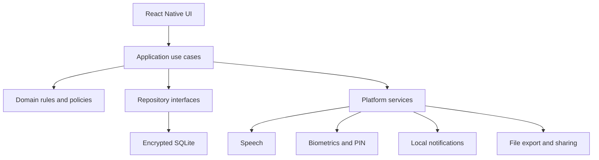
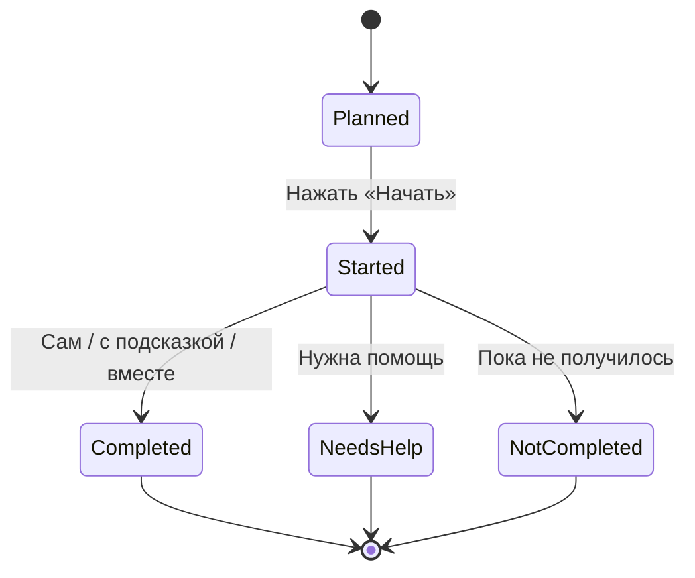

# Технический план разработки мобильного приложения «Мой вклад»

> Версия: 1.0  
> Дата: 26 августа 2026 года  
> Статус: технический план MVP  
> Связанный документ: [MOBILE_APP_PROJECT_PLAN.md](./MOBILE_APP_PROJECT_PLAN.md)

## 1. Назначение документа

Документ переводит продуктовый план приложения «Мой вклад» в технический план реализации. Он фиксирует:

- выбранный технологический стек;
- границы MVP и последующих версий;
- архитектуру клиентского приложения;
- модель локальных данных;
- бизнес-правила и алгоритмы;
- пользовательские сценарии;
- требования к безопасности, приватности и доступности;
- стратегию тестирования и выпуска;
- порядок работ, зависимости и критерии готовности.

Документ не заменяет юридическую экспертизу, исследование с семьями, UX-макеты и редакторскую проверку детских текстов.

## 2. Зафиксированные технические решения

### 2.1. Основной стек

| Область | Решение |
|---|---|
| Язык | TypeScript со строгой типизацией |
| UI-фреймворк | React Native |
| Инструментарий | Expo с Continuous Native Generation и config plugins |
| Среда разработки | Expo Development Build, не Expo Go как основная среда |
| Платформы MVP | Android и iOS |
| Навигация | Expo Router |
| Локальная база | `expo-sqlite` с SQLCipher |
| Схема и миграции | Drizzle ORM поверх SQLite либо тонкий типизированный SQL-слой |
| Безопасное хранилище | `expo-secure-store` |
| Системная аутентификация | `expo-local-authentication` |
| Локализация | FormatJS / `react-intl`, ICU MessageFormat |
| Озвучивание | `expo-speech` |
| Уведомления | локальные `expo-notifications` |
| Экспорт | `expo-file-system` и `expo-sharing` |
| Формы | React Hook Form + Zod |
| Локальное UI-состояние | React state; Zustand только при подтверждённой необходимости |
| Анимации | встроенные API React Native; Reanimated только для сложных сценариев |
| Тесты | Jest, React Native Testing Library, Maestro для E2E |
| Сборка | EAS Build с профилями development, preview и production |
| Сервер MVP | отсутствует |

Версии пакетов фиксируются в lock-файле. При создании проекта выбираются последние стабильные, взаимно совместимые версии Expo SDK и React Native. Canary, beta и experimental API не используются в критических сценариях.

### 2.2. Почему используется React Native

React Native покрывает все требования MVP без параллельной разработки двух нативных приложений:

- один TypeScript-код для Android и iOS;
- нативные компоненты интерфейса и accessibility API;
- доступ к SQLite, системному TTS, уведомлениям и биометрии;
- возможность добавить точечный модуль на Swift или Kotlin, если будет обнаружено платформенное ограничение;
- соответствие имеющимся компетенциям разработчика.

Flutter технически подходит, но не даёт продуктового преимущества, которое оправдало бы переход на Dart. HTML/PWA не выбирается как основа детского приложения: для SQLite, системной аутентификации, уведомлений и стабильного поведения в магазинах всё равно потребуется нативная оболочка. HTML можно использовать позднее для сайта, редактора контента или отдельной родительской панели.

### 2.3. Почему используется Expo Development Build

Expo Go допустим для раннего просмотра простых экранов, но не является целевой средой разработки. Собственная development-сборка нужна для:

- включения SQLCipher через config plugin;
- проверки Face ID и платформенных разрешений;
- поведения уведомлений на реальном устройстве;
- проверки конфигурации Android и iOS, близкой к production;
- добавления нативных модулей при необходимости.

### 2.4. Границы MVP

MVP работает полностью локально на одном устройстве. В нём нет:

- регистрации по email или телефону;
- удалённого backend;
- синхронизации между устройствами;
- облачной аналитики;
- загрузки фото, видео и голоса;
- AI-функций;
- социальных возможностей;
- покупок и рекламы.

Локальный `ParentAccount` в MVP означает семейное пространство на устройстве, а не сетевую учётную запись.

## 3. Цели архитектуры

Архитектура должна обеспечивать следующие свойства:

1. Приложение полностью работает без сети.
2. Данные ребёнка по умолчанию не покидают устройство.
3. Повторная обработка действия не начисляет XP второй раз.
4. Правила XP, инициативы и выпуска навыка тестируются без UI и базы данных.
5. Контент и грамматические формы проверяются автоматически.
6. Интерфейс ребёнка и родителя используют общую бизнес-логику, но разные права.
7. Будущая синхронизация добавляется без переписывания доменной модели.
8. Любые миграции базы сохраняют ранее созданные данные.
9. Весь критический функционал проверяется на Android и iOS.

## 4. Архитектура приложения

### 4.1. Общая схема



Зависимости направлены внутрь: UI и инфраструктура знают о прикладном и доменном слоях, но доменные правила не импортируют React Native, Expo или SQLite.

### 4.2. Слои

#### Presentation

Содержит:

- экраны Expo Router;
- компоненты;
- accessibility-разметку;
- локальное состояние формы и навигации;
- преобразование состояния use case в представление;
- вызов озвучивания и визуальной обратной связи.

UI не рассчитывает XP и не решает, освоен ли навык.

#### Application

Содержит отдельные use case:

- `CreateChildProfile`;
- `AssignTask`;
- `GenerateOccurrences`;
- `GetTodayPlan`;
- `CompleteTask`;
- `CreateInitiative`;
- `ReviewInitiative`;
- `EvaluateMastery`;
- `GraduateSkill`;
- `BuildWeeklyReview`;
- `ExportFamilyData`;
- `DeleteAllFamilyData`.

Use case открывает транзакцию, вызывает доменные политики и сохраняет результат через интерфейсы репозиториев.

#### Domain

Содержит:

- сущности и value objects;
- закрытые перечисления;
- политику начисления XP;
- политику дневного лимита;
- правила перехода между стадиями освоения;
- правила инициативы;
- правила отбора карточек дня;
- проверку безопасных переходов состояния.

Доменный слой реализуется на чистом TypeScript и покрывается основными unit-тестами.

#### Infrastructure

Содержит:

- реализацию репозиториев на SQLite;
- миграции;
- SQLCipher и работу с ключом;
- адаптеры Expo Speech, Notifications, SecureStore, LocalAuthentication;
- файловый экспорт;
- системные часы и генератор идентификаторов;
- локальное техническое логирование.

### 4.3. Предлагаемая структура каталогов

```text
app/
  _layout.tsx
  index.tsx
  child/
    today.tsx
    task/[occurrenceId].tsx
    task/[occurrenceId]/result.tsx
    initiative/index.tsx
    initiative/benefit.tsx
    skills.tsx
    compass.tsx
    journey.tsx
  parent/
    unlock.tsx
    profiles/
    tasks/
    initiatives/
    weekly-review.tsx
    privacy.tsx
    settings.tsx

src/
  application/
    ports/
    use-cases/
    dto/
  domain/
    entities/
    value-objects/
    policies/
    errors/
  infrastructure/
    database/
      schema/
      migrations/
      repositories/
      openEncryptedDatabase.ts
    security/
    notifications/
    speech/
    export/
    clock/
  features/
    child-today/
    task-completion/
    initiative/
    mastery/
    weekly-review/
    parent-gate/
  shared/
    ui/
    hooks/
    validation/
    constants/
  i18n/
    messages/
    formatMessage.ts
    contentValidation.ts

assets/
  icons/
  illustrations/
  task-content/

tests/
  unit/
  integration/
  e2e/
```

Группировка по features применяется в UI, а доменные правила остаются централизованными, чтобы разные экраны не создавали разные версии одного правила.

## 5. Модель состояния

### 5.1. Источники состояния

| Вид состояния | Источник |
|---|---|
| Профили, задачи, выполнения, XP | SQLite |
| Открытая форма и выбранная вкладка | React state |
| Текущая сессия родительского режима | память приложения |
| Ключ шифрования и данные PIN | SecureStore |
| Системные настройки TTS | настройки приложения в SQLite |
| Разрешения и доступность биометрии | операционная система |

SQLite является единственным источником истины для постоянных продуктовых данных. Нельзя хранить отдельную постоянную копию XP или стадии навыка в Zustand/Redux.

### 5.2. Обновление UI

После команды изменения данных use case возвращает новый DTO либо инвалидирует соответствующий query key. Для MVP допустим простой подход:

1. экран запрашивает DTO через application service;
2. use case выполняет транзакцию;
3. application service публикует локальное событие изменения;
4. активный экран повторно читает данные из SQLite.

Сложная event-sourcing архитектура для MVP не требуется. `xp_ledger` является журналом финансовоподобных начислений, но остальные таблицы хранят текущее состояние обычным способом.

## 6. Модель локальных данных

### 6.1. Общие правила

- Идентификаторы: UUID v4 или UUID v7 в строковом представлении.
- Время событий: UTC ISO 8601 либо integer epoch milliseconds.
- Календарный день ребёнка: отдельное поле `local_date` в формате `YYYY-MM-DD`.
- Часовой пояс семьи: IANA timezone, например `Europe/Moscow`.
- Булевы значения SQLite: `0 | 1` с проверкой на уровне схемы.
- Enum: `TEXT` с `CHECK` constraint и соответствующим TypeScript union.
- Удаление профиля: транзакционное каскадное удаление принадлежащих ему данных.
- Все миграции имеют номер, дату и автоматический тест обновления с предыдущей версии.

### 6.2. Таблицы

#### `schema_meta`

| Поле | Тип | Назначение |
|---|---|---|
| `key` | TEXT PK | Имя параметра |
| `value` | TEXT | Значение |

Хранит версию схемы, версию контента и marker текущей установки.

#### `family_settings`

| Поле | Тип | Ограничения |
|---|---|---|
| `id` | TEXT PK | В MVP одна запись |
| `locale` | TEXT | По умолчанию `ru-RU` |
| `timezone` | TEXT | Обязательное |
| `consent_version` | TEXT | Обязательное после принятия |
| `daily_xp_cap` | INTEGER | По умолчанию 50 |
| `notifications_enabled` | INTEGER | По умолчанию 0 |
| `sound_enabled` | INTEGER | По умолчанию 1 |
| `motion_enabled` | INTEGER | По умолчанию 1 |
| `created_at` | INTEGER | UTC |
| `updated_at` | INTEGER | UTC |

#### `child_profiles`

| Поле | Тип | Ограничения |
|---|---|---|
| `id` | TEXT PK | UUID |
| `display_name` | TEXT NULL | Имя необязательно |
| `child_gender` | TEXT | `male | female` |
| `age_band` | TEXT | `age_5_6 | age_7_8 | age_9` |
| `avatar_config_json` | TEXT | Только локальные идентификаторы ассетов |
| `active` | INTEGER | 0/1 |
| `created_at` | INTEGER | UTC |
| `updated_at` | INTEGER | UTC |

Поле `child_gender` не используется в XP, сложности или доступности заданий.

#### `task_templates`

| Поле | Тип | Назначение |
|---|---|---|
| `id` | TEXT PK | Стабильный ID контента |
| `content_version` | INTEGER | Версия каталога |
| `category` | TEXT | Категория |
| `title_key` | TEXT | Ключ локализации |
| `description_key` | TEXT | Текст для родителя |
| `age_min` | INTEGER | 5–9 |
| `age_max` | INTEGER | 5–9 |
| `duration_minutes` | INTEGER | Ориентир |
| `base_xp` | INTEGER | 5, 10, 15 или 20 |
| `supervision_level` | TEXT | `none | nearby | direct` |
| `safety_note_key` | TEXT NULL | Предупреждение |
| `active` | INTEGER | Скрытие без удаления истории |

#### `task_template_steps`

| Поле | Тип | Назначение |
|---|---|---|
| `id` | TEXT PK | UUID или стабильный content ID |
| `task_template_id` | TEXT FK | Шаблон |
| `position` | INTEGER | 1–5 |
| `instruction_key` | TEXT | Ключ текста |
| `icon_asset_id` | TEXT | Локальная иллюстрация |

Уникальный индекс: `(task_template_id, position)`.

#### `assigned_tasks`

| Поле | Тип | Назначение |
|---|---|---|
| `id` | TEXT PK | UUID |
| `child_profile_id` | TEXT FK | Владелец |
| `task_template_id` | TEXT FK NULL | Пусто для пользовательского действия |
| `custom_title` | TEXT NULL | Вводит только взрослый |
| `custom_steps_json` | TEXT NULL | До пяти шагов |
| `base_xp_override` | INTEGER NULL | Только разрешённые значения |
| `supervision_level` | TEXT | Уровень надзора |
| `mastery_stage` | TEXT | Стадия освоения |
| `stage_success_count` | INTEGER | Счётчик текущей стадии |
| `priority` | INTEGER | Для отбора карточек дня |
| `active` | INTEGER | 0/1 |
| `created_at` | INTEGER | UTC |
| `updated_at` | INTEGER | UTC |

Стадии: `learning | practice | independence_check | graduated`.

#### `schedule_rules`

| Поле | Тип | Назначение |
|---|---|---|
| `id` | TEXT PK | UUID |
| `assigned_task_id` | TEXT FK | Задание |
| `rule_type` | TEXT | `weekdays | interval | one_off` |
| `weekdays_json` | TEXT NULL | Массив 1–7 |
| `interval_days` | INTEGER NULL | Для интервала |
| `one_off_date` | TEXT NULL | `YYYY-MM-DD` |
| `preferred_time` | TEXT NULL | `HH:mm` |
| `start_date` | TEXT | Локальная дата |
| `end_date` | TEXT NULL | Локальная дата |
| `active` | INTEGER | 0/1 |

#### `task_occurrences`

Представляет конкретное запланированное выполнение задания в конкретный день.

| Поле | Тип | Назначение |
|---|---|---|
| `id` | TEXT PK | UUID |
| `assigned_task_id` | TEXT FK | Задание |
| `schedule_rule_id` | TEXT FK | Правило |
| `local_date` | TEXT | День ребёнка |
| `preferred_time` | TEXT NULL | Время |
| `status` | TEXT | `planned | started | completed | skipped` |
| `started_at` | INTEGER NULL | UTC |
| `closed_at` | INTEGER NULL | UTC |

Уникальный индекс: `(assigned_task_id, schedule_rule_id, local_date)`. Он защищает от повторного создания карточки при каждом запуске приложения.

#### `task_completions`

| Поле | Тип | Назначение |
|---|---|---|
| `id` | TEXT PK | UUID |
| `occurrence_id` | TEXT FK UNIQUE | Одно завершение на occurrence |
| `assistance_level` | TEXT | Уровень помощи |
| `started_without_reminder` | INTEGER | 0/1 |
| `new_step_attempted` | INTEGER | 0/1, при наличии milestone |
| `outcome` | TEXT | `success | needs_help | not_completed` |
| `self_reported_at` | INTEGER | UTC |
| `parent_review_status` | TEXT | `not_required | pending | reviewed` |
| `parent_reviewed_at` | INTEGER NULL | UTC |

Уровни помощи: `independent | reminder | together | needs_help | not_completed`.

#### `initiatives`

| Поле | Тип | Назначение |
|---|---|---|
| `id` | TEXT PK | UUID |
| `child_profile_id` | TEXT FK | Автор |
| `category` | TEXT | Разрешённая категория |
| `preset_action_id` | TEXT NULL | Готовое действие |
| `icon_asset_id` | TEXT | Готовая пиктограмма |
| `parent_entered_text` | TEXT NULL | Вводит взрослый |
| `benefit_category` | TEXT | Кому или чему помогло |
| `review_status` | TEXT | `pending | reviewed` |
| `review_decision` | TEXT NULL | Решение взрослого |
| `safety_status` | TEXT | `unknown | safe | adult_required | unsafe` |
| `repeat_group_key` | TEXT NULL | Для обнаружения повторений |
| `local_date` | TEXT | День ребёнка |
| `created_at` | INTEGER | UTC |
| `reviewed_at` | INTEGER NULL | UTC |

#### `xp_ledger`

Неизменяемый журнал начислений.

| Поле | Тип | Назначение |
|---|---|---|
| `id` | TEXT PK | UUID |
| `child_profile_id` | TEXT FK | Получатель |
| `source_type` | TEXT | `task | initiative | graduation` |
| `source_id` | TEXT | ID исходного события |
| `idempotency_key` | TEXT UNIQUE | Защита от повтора |
| `base_amount` | INTEGER | База |
| `bonus_amount` | INTEGER | Бонус 0–5 |
| `stage_multiplier` | REAL | 1, 0.5 или 0 |
| `cap_reduction` | INTEGER | Сколько отсечено лимитом |
| `awarded_amount` | INTEGER | Фактическое начисление |
| `reason` | TEXT | Код причины |
| `local_date` | TEXT | Для дневного лимита |
| `created_at` | INTEGER | UTC |

Общий XP вычисляется как `SUM(awarded_amount)`. Записи не редактируются и не удаляются отдельно от полного удаления профиля. Отрицательные начисления не используются.

#### `mastery_events`

| Поле | Тип | Назначение |
|---|---|---|
| `id` | TEXT PK | UUID |
| `assigned_task_id` | TEXT FK | Навык |
| `from_stage` | TEXT | Предыдущая стадия |
| `to_stage` | TEXT | Новая стадия |
| `reason` | TEXT | Автоматическое правило или решение родителя |
| `created_at` | INTEGER | UTC |

#### `independence_markers`

| Поле | Тип | Назначение |
|---|---|---|
| `id` | TEXT PK | UUID |
| `child_profile_id` | TEXT FK | Профиль |
| `marker_type` | TEXT | Тип признака |
| `source_type` | TEXT | `task | initiative | review` |
| `source_id` | TEXT | Исходное событие |
| `created_at` | INTEGER | UTC |

Уникальный индекс: `(marker_type, source_type, source_id)`.

#### `weekly_reviews`

| Поле | Тип | Назначение |
|---|---|---|
| `id` | TEXT PK | UUID |
| `child_profile_id` | TEXT FK | Профиль |
| `week_start_date` | TEXT | Начало недели |
| `summary_json` | TEXT | Зафиксированный снимок метрик |
| `family_note` | TEXT NULL | Вводит взрослый |
| `completed_at` | INTEGER NULL | UTC |

#### `parent_audit_log`

Содержит только необходимые локальные события изменения настроек: создание задания, изменение расписания, подтверждение инициативы, выпуск навыка, экспорт и удаление. Детскому режиму журнал недоступен.

### 6.3. Индексы

Обязательные индексы:

- `task_occurrences(local_date, status)`;
- `assigned_tasks(child_profile_id, active)`;
- `task_completions(occurrence_id)`;
- `initiatives(child_profile_id, local_date, review_status)`;
- `xp_ledger(child_profile_id, local_date)`;
- `mastery_events(assigned_task_id, created_at)`;
- `weekly_reviews(child_profile_id, week_start_date)`.

## 7. Бизнес-логика

### 7.1. Создание семейного пространства

1. Приложение создаёт случайный 256-битный ключ базы.
2. Ключ сохраняется в SecureStore.
3. Открывается SQLCipher-база и выполняются миграции.
4. Родитель читает и принимает актуальную версию согласия.
5. Создаётся локальное семейное пространство.
6. Родителю предлагается настроить системную аутентификацию и резервный PIN.
7. До создания профиля ребёнка сетевые запросы не выполняются.

### 7.2. Создание профиля ребёнка

Обязательные данные:

- `child_gender` без значения по умолчанию;
- возрастная группа;
- аватар из локального набора.

Имя необязательно. Перед сохранением показывается пояснение, что пол нужен только для русской грамматики. Сохранение невозможно, пока родитель явно не выбрал вариант.

После создания профиля родителю предлагается выбрать 2–4 навыка на неделю. Валидатор предупреждает, если расписание создаёт более трёх главных карточек в один день.

### 7.3. Генерация расписания

Occurrence создаются лениво:

1. при запуске приложения;
2. после изменения расписания;
3. после смены часового пояса;
4. при переходе на новый локальный день.

Генерируется окно от текущего дня до 14 дней вперёд. Уникальный индекс не допускает дублей.

Изменение правила расписания:

- не меняет прошлые occurrence;
- обновляет только будущие незавершённые occurrence;
- не удаляет историю выполнений;
- требует повторного планирования локальных уведомлений.

### 7.4. Отбор карточек «Сегодня»

На главном детском экране показывается не более трёх карточек.

Порядок отбора:

1. активные occurrence текущего локального дня;
2. ещё не завершённые;
3. задания с явно установленным родителем приоритетом;
4. более раннее `preferred_time`;
5. более старое назначение задания.

Если из-за смены расписания возникло более трёх карточек, ребёнку показываются три, а родителю — предупреждение о конфликте. Приложение не помечает скрытые карточки как пропущенные автоматически.

### 7.5. Выполнение обычного задания



Последовательность:

1. Ребёнок открывает карточку.
2. Приложение показывает 2–5 шагов и может озвучить их.
3. Нажатие «Начать» фиксирует `started_at`.
4. Приложение предлагает отложить устройство.
5. Ребёнок выбирает один результат.
6. `CompleteTask` в одной транзакции создаёт completion, рассчитывает XP, добавляет marker и обновляет стадию навыка.
7. Интерфейс показывает содержательную фразу, а не оценку личности.
8. Повторная отправка с тем же occurrence возвращает уже созданный результат.

Для MVP обычное задание учитывается по самоотчёту ребёнка и начисляет XP сразу. Родитель может просмотреть результат, но обязательное ежедневное подтверждение не требуется. Это уменьшает нагрузку и не задерживает детский сценарий. Если исследование покажет необходимость обязательного подтверждения, поле `parent_review_status` позволяет добавить его без миграции основной модели.

### 7.6. Расчёт XP за задание

Базовая формула:

```text
eligible_bonus = stage_multiplier > 0 ? bonus_xp : 0
raw_xp = round_to_allowed_step(base_xp × stage_multiplier) + eligible_bonus
awarded_xp = min(raw_xp, remaining_daily_cap)
```

Коэффициенты MVP:

| Стадия | Коэффициент |
|---|---:|
| `learning` | 1.0 |
| `practice` | 0.5 |
| `independence_check` | 0.0 |
| `graduated` | 0.0 |

На стадии проверки самостоятельности ребёнок заранее получает объяснение, что очки больше не начисляются, потому что навык уже почти освоен. Выпуск навыка даёт карточку достижения, но не материальную награду.

Правила:

- `independent`, `reminder` и `together` считаются успешным выполнением;
- `needs_help` и `not_completed` дают 0 XP и не считаются провалом;
- бонус за самостоятельное начало — 5 XP;
- бонус за новый сложный шаг — 5 XP;
- суммарный бонус одного выполнения не превышает 5 XP;
- на стадиях `independence_check` и `graduated` бонус также равен 0;
- дневной лимит по умолчанию — 50 XP на ребёнка;
- остаток меньше начисления обрезает начисление до остатка;
- повторное нажатие не создаёт новую запись благодаря `idempotency_key = task:{occurrence_id}`;
- XP никогда не отнимается за пропуск или изменение оценки взрослого.

Половина XP округляется до целого значения, кратного 5. Примеры: 5 → 5, 10 → 5, 15 → 10, 20 → 10. Конкретная функция округления фиксируется unit-тестами и не меняется без миграции продуктовых правил.

### 7.7. Освоение навыка

Настройки по умолчанию:

- обучение: 6 успешных повторений;
- практика: ещё 6 успешных повторений;
- проверка: окно из последних 5 запланированных occurrence;
- кандидат на выпуск: минимум 4 успеха из 5 и минимум 3 выполнения без прямой помощи.

Переходы:


Успешное выполнение с помощью засчитывается в обучение, но не является доказательством самостоятельности. `needs_help` не сбрасывает прогресс. Пропуск не уменьшает счётчик.

Автоматически создаётся кандидат на выпуск, но окончательный выпуск подтверждает родитель. При выпуске:

- `mastery_stage` становится `graduated`;
- ежедневные occurrence больше не создаются;
- навык появляется в «Я это умею»;
- сохраняется `mastery_event`;
- приложение предлагает выбрать следующий навык.

### 7.8. Инициатива

Инициативу всегда начинает ребёнок. Родитель не может создать её от имени ребёнка.

Сценарий:

1. Ребёнок нажимает «Я сам придумал» или «Я сама придумала».
2. Выбирает категорию.
3. Выбирает готовую пиктограмму и действие.
4. Выбирает, кому или чему это помогло.
5. При необходимости передаёт устройство взрослому для короткого текста.
6. Создаётся запись `pending` без XP.
7. Взрослый открывает защищённый режим и выбирает решение.
8. `ReviewInitiative` начисляет XP один раз либо сохраняет 0 XP с уважительной обратной связью.

Решения:

| Решение | XP | Safety status |
|---|---:|---|
| Самостоятельная полезная инициатива | 10 | `safe` |
| Новый безопасный навык | 15 | `safe` |
| Самостоятельное исправление ошибки | 10 | `safe` |
| Хорошая идея, сделанная вместе | 5 | `safe` или `adult_required` |
| Можно только со взрослым | 0 | `adult_required` |
| Небезопасно или неполезно | 0 | `unsafe` |

Ограничения:

- не более одной XP-инициативы на ребёнка в локальный день;
- остальные инициативы остаются в дневнике с 0 XP;
- `idempotency_key = initiative:{initiative_id}`;
- одинаковые preset action формируют один `repeat_group_key`;
- после третьего повторения родителю показывается предложение превратить действие в постоянную ответственность;
- свободный текст не анализируется автоматически и не отправляется в сеть;
- небезопасная инициатива не создаёт отрицательное событие или потерю XP.

### 7.9. Компас самостоятельности

Marker создаются из фактических событий:

| Marker | Условие |
|---|---|
| `noticed` | подтверждённая самостоятельная инициатива |
| `started_independently` | выполнение без напоминания |
| `proposed_solution` | соответствующая категория инициативы |
| `asked_for_help` | выбран `needs_help` до завершения |
| `fixed_mistake` | подтверждена соответствующая инициатива |
| `cared_for_shared_space` | подтверждена соответствующая benefit/category |

Компас показывает накопленные примеры, а не проценты нормы, рейтинг или итоговую оценку ребёнка.

### 7.10. Пропуск

Occurrence не считается пропущенным только потому, что день закончился. При следующем входе приложение предлагает нейтральный сценарий:

- перенести;
- изменить время;
- разделить на шаги;
- добавить помощь;
- временно заменить задачу;
- оставить без изменений.

Закрытие occurrence со статусом `skipped`:

- не создаёт отрицательного XP;
- не уменьшает прогресс;
- не запускает стыдящее уведомление;
- сохраняется только для недельного обзора и адаптации плана.

### 7.11. Недельный обзор

Обзор строится запросом по завершённой календарной неделе и содержит:

- количество запланированных и выполненных действий;
- распределение уровней помощи;
- навыки, где помощь уменьшилась;
- запросы помощи;
- подтверждённые инициативы;
- кандидаты на выпуск;
- возможные конфликты расписания;
- вопросы для короткого семейного обсуждения.

В обзоре нет оценок, сравнения детей, красных провалов и нормы «должен был выполнить».

### 7.12. Несколько детей

- Каждый профиль имеет отдельный план, XP, навыки и компас.
- Главный экран не показывает сравнительную таблицу.
- Родитель переключает профиль явно.
- Детский режим не позволяет открыть профиль другого ребёнка без возвращения на нейтральный экран выбора.
- Дневной лимит применяется отдельно к каждому ребёнку.

## 8. Локализация и контент

### 8.1. Правила локализации

- Ни одна персональная фраза не собирается конкатенацией частей.
- Используется ICU `select` с `male`, `female` и техническим `other`.
- В `other` нельзя показывать неверную грамматическую форму; при невозможном значении фиксируется ошибка и используется нейтральная фраза.
- В базе хранятся ключи контента, а не готовые переведённые строки.
- Пользовательские названия хранятся отдельно и не проходят грамматическое преобразование.
- Текст сначала полностью форматируется, затем передаётся TTS и accessibility label.

Пример:

```ts
const messages = {
  initiativeTitle: {
    defaultMessage:
      '{gender, select, male {Я сам придумал} female {Я сама придумала} other {Моя идея}}',
  },
};
```

### 8.2. Контентный пакет

Предустановленные задания хранятся как версионированные JSON/TypeScript-данные:

```text
assets/task-content/
  catalog.ru.json
  steps.ru.json
  safety.ru.json
  manifest.json
```

Каждый пакет проверяется Zod-схемой:

- стабильный уникальный ID;
- возраст 5–9;
- допустимый XP;
- 2–5 шагов;
- существующие ключи локализации;
- существующие локальные ассеты;
- safety note для действий с надзором;
- отсутствие запрещённых категорий и формулировок.

Обновление встроенного каталога не меняет исторические выполнения. Удалённый из нового каталога шаблон помечается неактивным, но остаётся доступным истории.

### 8.3. Автоматические проверки текста

CI завершается ошибкой, если:

- отсутствует male/female branch;
- встречается шаблон вида `(а)`, `/а` или аналогичная сокращённая форма;
- ключ используется в коде, но отсутствует в каталоге;
- есть неиспользуемый или дублирующий ключ;
- ICU-строка не парсится;
- TTS-текст содержит техническую разметку;
- в детском контенте найдены запрещённые фразы из контрольного словаря.

Автоматический словарь не заменяет редакторскую проверку.

## 9. Озвучивание и звук

Правила TTS:

- язык `ru-RU`;
- одновременно звучит не более одной фразы;
- новое нажатие останавливает предыдущую фразу;
- переход с экрана останавливает очередь;
- скорость по умолчанию ниже системной средней и проверяется с детьми;
- озвучивание доступно отдельной крупной кнопкой;
- настройка звука хранится на уровне семейного пространства;
- отсутствие русского голоса обрабатывается понятным сообщением родителю;
- работа на iPhone отдельно тестируется с включённым беззвучным режимом.

TTS не заменяет VoiceOver/TalkBack. Кнопки должны иметь корректные accessibility label и hint независимо от настройки озвучивания.

## 10. Родительский режим и безопасность

### 10.1. Родительский gate

Приоритет способов входа:

1. системная биометрия или код устройства;
2. резервный PIN приложения;
3. повторная настройка только через отдельный безопасный сценарий.

Требования к PIN:

- минимум 4 цифры;
- хранится только verifier, не открытый PIN;
- не является ключом SQLCipher;
- после последовательных ошибок ввод получает возрастающую задержку;
- ошибки не логируются вместе с введёнными значениями;
- родительская сессия закрывается после ухода приложения в фон или короткого периода бездействия.

Gate защищает настройки от ребёнка, но не позиционируется как защита от владельца физически скомпрометированного устройства.

### 10.2. Шифрование

- База шифруется SQLCipher.
- Ключ базы генерируется случайно и хранится в SecureStore.
- Ключ не выводится в логи, отчёты об ошибках или экспорт.
- После полного удаления данных удаляются файл БД, связанные временные файлы и ключ SecureStore.
- На iOS Keychain может пережить переустановку, поэтому новая установка проверяет installation marker и при необходимости ротирует старый ключ.
- Временный plaintext-файл экспорта удаляется после завершения или отмены share flow.

### 10.3. Экспорт

Основной формат — версионированный JSON:

```json
{
  "format": "my-contribution-export",
  "version": 1,
  "exportedAt": "2026-08-26T12:00:00Z",
  "family": {},
  "children": [],
  "tasks": [],
  "completions": [],
  "initiatives": [],
  "xpLedger": []
}
```

Перед экспортом приложение сообщает, что полученный файл больше не защищён шифрованием приложения. Экспорт запускается только из открытого родительского режима.

### 10.4. Полное удаление

Последовательность:

1. повторная аутентификация взрослого;
2. явное подтверждение с описанием последствий;
3. закрытие соединения SQLite;
4. удаление БД и временных экспортов;
5. удаление ключей SecureStore;
6. отмена локальных уведомлений;
7. очистка кэша ассетов, созданного пользователем;
8. переход на чистый onboarding.

Операция не синхронизируется с сервером, поскольку backend отсутствует в MVP.

### 10.5. Логи

Допустимы:

- код экрана;
- код ошибки;
- версия схемы;
- версия приложения;
- длительность технической операции.

Запрещены:

- имя ребёнка;
- свободный текст;
- PIN и ключи;
- содержимое экспорта;
- полные записи инициатив;
- текст пользовательского задания.

Production-логи по умолчанию локальные и минимальные.

## 11. Доступность и детский UX

### 11.1. Обязательные требования

- минимальная зона нажатия 48×48 dp;
- поддержка системного увеличения текста;
- отсутствие фиксированной высоты у текстовых кнопок;
- контраст не ниже применимого уровня WCAG;
- смысл не передаётся только цветом;
- каждая пиктограмма имеет текстовую подпись;
- все интерактивные элементы имеют role, label, state и при необходимости hint;
- порядок фокуса VoiceOver/TalkBack соответствует визуальному порядку;
- управление не требует точного swipe или drag;
- звук, вибрацию и анимацию можно отключить;
- режим уменьшения движения учитывается;
- основной сценарий доступен без чтения длинного текста;
- нет бесконечной прокрутки, таймеров и неожиданных автопереходов.

### 11.2. Проверка на устройствах

Минимальная матрица:

- компактный Android-телефон;
- актуальный Android среднего размера;
- iPhone минимально поддерживаемого размера;
- современный iPhone;
- системный размер текста 100%, 150% и максимальный поддерживаемый;
- TalkBack;
- VoiceOver;
- звук включён/выключен;
- reduce motion;
- светлая и тёмная системная тема, даже если MVP использует одну собственную тему.

## 12. Уведомления

В MVP используются только локальные уведомления.

Правила:

- по умолчанию выключены;
- включаются и настраиваются взрослым;
- адресованы родителю либо используют нейтральную формулировку;
- не содержат имени ребёнка на lock screen по умолчанию;
- не используют чувство вины, срочность и угрозу потери;
- учитывают quiet hours;
- перепланируются при изменении времени, часового пояса или активности задания;
- удаляются при удалении задания или всех данных;
- отсутствие разрешения не блокирует приложение.

Push-инфраструктура в MVP не создаётся.

## 13. Обработка ошибок

Ошибки разделяются на:

- `ValidationError` — некорректные данные формы;
- `DomainRuleError` — запрещённый переход состояния;
- `StorageError` — ошибка базы или миграции;
- `PlatformCapabilityError` — нет TTS, биометрии или разрешения;
- `ExportError` — невозможно создать или передать файл;
- `UnexpectedError` — непредвиденная техническая ошибка.

Правила UI:

- ребёнку показывается короткая нейтральная фраза и безопасный следующий шаг;
- технические детали доступны только взрослому;
- повтор операции не должен создавать дубль;
- при ошибке записи XP транзакция откатывает completion целиком;
- ошибка TTS не блокирует чтение карточки;
- ошибка уведомления не блокирует расписание;
- ошибка экспорта не изменяет данные.

## 14. Тестирование

### 14.1. Пирамида тестов

#### Unit-тесты

Покрывают:

- XP по всем стадиям;
- бонус и дневной лимит;
- идемпотентность;
- переходы освоения;
- отсутствие потери прогресса при пропуске;
- инициативы и дневной лимит инициатив;
- generation расписания и границы дат;
- смену часового пояса;
- выбор трёх карточек;
- мужские и женские формы;
- запрещённые переходы состояния.

Цель покрытия для domain/application: не менее 90% ветвей критических правил. Общий процент проекта не используется как единственная метрика качества.

#### Интеграционные тесты

Проверяют реальную SQLite-базу:

- миграции с каждой поддерживаемой версии;
- foreign keys и cascade delete;
- уникальные индексы occurrence и ledger;
- транзакционность `CompleteTask`;
- восстановление после принудительного завершения между операциями;
- экспорт и повторный разбор JSON;
- удаление профиля и всех связанных данных.

#### Component-тесты

Проверяют:

- состояния загрузки и ошибки;
- крупный текст;
- accessibility labels;
- недоступность запрещённых действий;
- корректную локализованную обратную связь;
- отсутствие двойной отправки формы.

#### E2E

Минимальные сценарии:

1. onboarding → профиль мальчика → задача → выполнение;
2. onboarding → профиль девочки → инициатива → подтверждение;
3. повторное нажатие не удваивает XP;
4. достижение дневного лимита;
5. переход learning → practice → independence check → graduated;
6. пропуск без потери XP;
7. вход в родительский режим;
8. экспорт;
9. полное удаление;
10. перезапуск приложения без потери данных.

### 14.2. Ручные проверки

Обязательно вручную:

- TTS на реальных Android и iPhone;
- VoiceOver и TalkBack;
- биометрия и fallback;
- локальные уведомления после перезагрузки устройства;
- SQLCipher: файл нельзя прочитать обычным SQLite-клиентом;
- удаление временного export-файла;
- поведение после обновления приложения;
- офлайн-режим и airplane mode;
- смена системной даты, времени и часового пояса.

### 14.3. Product QA

Редактор, PM и специалист по детскому развитию проверяют:

- отсутствие стыда и оценочных ярлыков;
- безопасность всех 20+ заданий;
- соответствие возрастным группам;
- обе грамматические версии;
- понятность пиктограмм;
- длительность ежедневного экранного сценария;
- отсутствие способов бесконечного фарма XP.

## 15. CI/CD и среды

### 15.1. Проверки pull request

Каждый PR должен пройти:

1. TypeScript `tsc --noEmit`;
2. ESLint;
3. formatter check;
4. unit-тесты;
5. интеграционные тесты базы;
6. валидацию ICU и контента;
7. проверку миграций;
8. сканирование зависимостей;
9. создание preview build для значимых UI-изменений.

### 15.2. Профили сборки

| Профиль | Назначение |
|---|---|
| `development` | development client и отладка на устройствах |
| `preview` | внутренняя QA-сборка |
| `pilot` | закрытый пилот с production-подобной конфигурацией |
| `production` | магазины приложений |

Для каждого профиля используются отдельные bundle/application identifiers, чтобы тестовая сборка не могла открыть production-базу.

### 15.3. Обновления

OTA-обновления допустимы только при соблюдении правил совместимости:

- JS-код совместим с установленной нативной runtime version;
- миграция базы протестирована;
- критическое обновление приватности не обходится без нового согласия;
- нельзя откатывать JS на версию, не понимающую новую схему базы;
- новая нативная зависимость всегда требует новой store build.

## 16. План работ

Оценка ниже рассчитана для одного опытного React Native-разработчика при наличии готовых UX-макетов и контента. Исследования, юридическая работа и пилот идут отдельными потоками. Реалистичная длительность технического MVP: 9–12 недель разработки плюс закрытый пилот.

### Этап 0. Техническая подготовка — 3–5 дней

Задачи:

- подтвердить минимальные версии Android и iOS;
- создать репозиторий и правила ветвления;
- зафиксировать ADR по стеку и local-first;
- создать Expo-проект с TypeScript;
- настроить development build;
- настроить lint, format, tests и CI;
- согласовать Definition of Done;
- подготовить backlog эпиков.

Результат:

- пустое приложение собирается на Android и iOS;
- CI проходит;
- development build установлен минимум на двух реальных устройствах.

### Этап 1. Архитектурный фундамент — 1 неделя

Задачи:

- создать слои application/domain/infrastructure;
- настроить Expo Router;
- подключить SQLCipher;
- реализовать lifecycle ключа и SecureStore;
- создать миграции v1;
- настроить dependency composition;
- реализовать базовый обработчик ошибок;
- добавить светлую дизайн-тему и базовые accessible-компоненты.

Критерии приёмки:

- зашифрованная БД открывается после перезапуска;
- миграция выполняется атомарно;
- файл БД не читается обычным SQLite;
- UI не импортирует конкретные SQLite-репозитории напрямую.

### Этап 2. Onboarding и профили — 1 неделя

Задачи:

- согласие и privacy summary;
- создание семейного пространства;
- настройка родительского gate;
- создание и редактирование нескольких профилей;
- обязательный выбор пола и возраста;
- выбор аватара;
- переключение детского профиля;
- локализация и тесты обеих форм.

Критерии приёмки:

- профиль нельзя сохранить без пола и возраста;
- пол влияет только на форматируемый текст;
- детский режим не открывает родительские настройки;
- после перезапуска профили сохраняются.

### Этап 3. Каталог, назначения и расписание — 1–1,5 недели

Задачи:

- подготовить 20+ task templates;
- реализовать content validator;
- экран выбора навыков;
- пользовательское действие взрослого;
- schedule rules;
- generation occurrence;
- конфликт более трёх карточек;
- локальные напоминания;
- уровни надзора и safety notes.

Критерии приёмки:

- расписание не создаёт дубли;
- прошлые записи не меняются после правки расписания;
- ребёнок видит максимум три главные карточки;
- опасные задачи всегда показывают требуемый надзор.

### Этап 4. Ежедневный детский цикл и XP — 1,5–2 недели

Задачи:

- экран «Сегодня»;
- карточка действия и 2–5 шагов;
- TTS;
- «Начать» и предложение отложить телефон;
- форма результата;
- XP ledger;
- дневной лимит;
- защита от повторного начисления;
- нейтральный сценарий пропуска;
- спокойная обратная связь.

Критерии приёмки:

- основной экранный сценарий занимает менее минуты;
- двойное нажатие создаёт одно завершение и одно начисление;
- `needs_help` даёт поддерживающую фразу и 0 XP;
- пропуск не уменьшает общий XP;
- приложение работает в airplane mode.

### Этап 5. Освоение навыка — 1 неделя

Задачи:

- стадии learning/practice/independence check;
- расчёт rolling window;
- кандидат на выпуск;
- подтверждение выпуска взрослым;
- раздел «Я это умею»;
- выбор следующего навыка;
- mastery history.

Критерии приёмки:

- переходы соответствуют доменным тестам;
- XP постепенно прекращается;
- просьба о помощи не сбрасывает прогресс;
- выпущенный навык сохраняется без ежедневного XP.

### Этап 6. Инициатива и компас — 1–1,5 недели

Задачи:

- постоянная кнопка инициативы;
- категории, пиктограммы и benefit;
- ввод текста только взрослым;
- очередь подтверждений;
- safety decisions;
- дневной XP-лимит инициативы;
- repeat group;
- предложение постоянной ответственности;
- independence markers и компас.

Критерии приёмки:

- родитель не может инициировать запись от имени ребёнка;
- до review XP не начисляется;
- повторный review не начисляет XP снова;
- небезопасная попытка не называется провалом;
- компас не показывает рейтинг или нормативный процент.

### Этап 7. Недельный обзор, экспорт и удаление — 1 неделя

Задачи:

- weekly summary query;
- вопросы семейного обсуждения;
- JSON export;
- системный share flow;
- полное удаление;
- аудит родительских изменений;
- проверка временных файлов.

Критерии приёмки:

- обзор не сравнивает детей;
- экспорт проходит схему обратного чтения;
- после полного удаления не остаются БД, уведомления и ключ;
- удаление требует повторной аутентификации.

### Этап 8. Доступность и стабилизация — 1–2 недели

Задачи:

- VoiceOver/TalkBack audit;
- максимальный системный текст;
- reduced motion;
- матрица устройств;
- performance profiling;
- восстановление после ошибок и закрытия приложения;
- аудит зависимостей;
- редакторская проверка;
- исправление результатов семейного usability-теста.

Критерии приёмки:

- нет блокирующих P0/P1-дефектов;
- ключевые сценарии проходят E2E на Android и iOS;
- нет критических accessibility-дефектов;
- production-конфигурация не содержит рекламных и аналитических SDK.

### Этап 9. Закрытый пилот — 6 недель

Технические задачи во время пилота:

- поддержка установки и обновлений;
- сбор только согласованных обезличенных итогов либо ручных исследовательских данных;
- журнал критических ошибок без детского контента;
- еженедельный triage;
- заморозка крупных изменений бизнес-правил внутри одной тестовой когорты;
- анализ переносимости данных между версиями.

Результат пилота — решение о продолжении, изменении механики или остановке продукта.

## 17. Backlog MVP по эпикам

| Epic | Приоритет | Зависимости |
|---|---|---|
| Foundation и CI | P0 | Нет |
| Encrypted local storage | P0 | Foundation |
| Parent gate | P0 | SecureStore |
| Profiles и onboarding | P0 | DB, i18n |
| Content catalog | P0 | Profiles, content schema |
| Scheduling | P0 | Assigned tasks |
| Today flow | P0 | Scheduling |
| XP ledger | P0 | Completion |
| Mastery fading | P0 | XP, history |
| Initiative review | P0 | Parent gate, profiles |
| Compass | P0 | Completion, initiative |
| Weekly review | P0 | History |
| Notifications | P0 | Scheduling, settings |
| Accessibility | P0 | Все UI-эпики |
| Export/delete | P0 | Все таблицы, security |
| Multi-device sync | P1 | Отдельный backend design |
| Photos/voice/AI | P2 | Отдельное исследование рисков |

## 18. Роли и ответственность

### Product manager

- управляет P0/P1/P2;
- принимает продуктовые правила и изменения коэффициентов;
- не допускает роста scope внутри спринта без снятия другой задачи;
- организует исследования и weekly triage;
- согласует защитные метрики;
- принимает решение о выпуске пилота.

### React Native developer

- реализует архитектуру и миграции;
- поддерживает сборки Android/iOS;
- пишет domain, integration и E2E-тесты;
- документирует технические решения;
- контролирует зависимости и отсутствие скрытого трекинга;
- участвует в accessibility-проверке.

### Product/UX designer

- проектирует отдельные режимы ребёнка и взрослого;
- обеспечивает крупные зоны, короткий сценарий и состояния ошибок;
- готовит дизайн-систему и локальные ассеты;
- проверяет максимальный размер текста и reduced motion.

### Редактор детского контента

- проверяет мужские и женские формы;
- поддерживает словарь допустимых и запрещённых формулировок;
- согласует TTS-тексты;
- проверяет короткость и понятность фраз.

### Специалист по детскому развитию

- проверяет механику мотивации;
- оценивает формулировки пропуска и помощи;
- участвует в анализе пилота;
- не получает автоматическую «диагностику» ребёнка из приложения.

### QA

- ведёт device matrix;
- проверяет accessibility, уведомления, обновления и удаления;
- проводит regression перед каждой pilot build.

## 19. Definition of Done

Задача считается завершённой, если:

- выполнены acceptance criteria;
- есть состояния loading, empty, error и retry;
- добавлены accessibility label/state/hint;
- добавлены или обновлены unit/integration тесты;
- обе грамматические формы проверены;
- нет новых персональных данных в логах;
- проверено offline-поведение;
- миграция добавлена при изменении схемы;
- документация обновлена;
- PR прошёл CI и review;
- функция проверена минимум на Android и iOS, если затрагивает платформенный API.

## 20. Основные технические риски

| Риск | Вероятность | Влияние | Мера |
|---|---:|---:|---|
| Различия TTS на устройствах | Средняя | Среднее | Device matrix, выбор голоса, текстовый fallback |
| SQLCipher/config plugin усложняет сборку | Средняя | Высокое | Development build с первой недели |
| Ошибка миграции уничтожает локальные данные | Низкая | Критическое | Транзакции, migration fixtures, backup strategy |
| Дубли XP из-за повторного события | Средняя | Высокое | UNIQUE idempotency key и одна транзакция |
| Сложная русская грамматика | Высокая | Высокое | ICU, content validation, редактор, обе версии E2E |
| Более трёх карточек из-за расписания | Средняя | Среднее | Валидация при настройке и детерминированный отбор |
| Родительский gate неудобен | Средняя | Среднее | Биометрия + PIN, короткая сессия, usability test |
| Потеря ключа SecureStore | Низкая | Критическое | Понятный recovery policy; не хранить irreplaceable cloudless data без предупреждения |
| Экспорт оставляет plaintext | Средняя | Высокое | Временный каталог, cleanup, явное предупреждение |
| Scope P1 проникает в MVP | Высокая | Высокое | Backend отсутствует, отдельный decision gate |
| Зависимость содержит трекинг | Низкая | Высокое | Allowlist библиотек и dependency audit |
| UI не помещается при крупном тексте | Средняя | Высокое | Без фиксированных высот, раннее тестирование |

## 21. Подготовка к P1-синхронизации

В MVP backend не создаётся, но локальная модель готовится к синхронизации:

- UUID генерируются на устройстве;
- `created_at` и `updated_at` присутствуют у изменяемых сущностей;
- бизнес-операции идемпотентны;
- XP ledger имеет стабильный source ID;
- удаление в будущей версии потребует tombstone, а не мгновенного server delete;
- repository interfaces не зависят от SQLite DTO;
- формат экспорта версионирован.

Перед P1 принимаются отдельные решения:

- модель семейной учётной записи и проверяемого согласия;
- способ приглашения второго взрослого;
- права доступа;
- conflict resolution;
- end-to-end или server-side encryption;
- регион хранения;
- политика удаления резервных копий;
- минимальная телеметрия;
- юридические требования рынков запуска.

Предварительный серверный стек при подтверждении P1:

- TypeScript;
- Node.js с Fastify или NestJS;
- PostgreSQL;
- OpenAPI-контракт;
- background jobs только для синхронизации и удаления;
- без рекламной идентификации и стороннего профилирования.

Окончательный backend выбирается только после проектирования threat model и consent flow.

## 22. Решения, требующие продуктового подтверждения до разработки

Следующие параметры должны стать конфигурацией домена и получить явное подтверждение PM:

1. Дневной лимит: предлагается 50 XP.
2. Learning: предлагается 6 успешных повторений.
3. Practice: предлагается ещё 6 успешных повторений.
4. Independence check: предлагается 0 ежедневного XP.
5. Выпуск: 4 успеха из 5 и минимум 3 без прямой помощи.
6. Повтор инициативы: предложение ответственности после третьего раза.
7. Обычные задания: самоотчёт с немедленным XP; review родителя необязателен.
8. Инициатива: XP только после обязательного review взрослого.
9. Срок хранения локального audit log.
10. Минимальные поддерживаемые версии Android и iOS.

Изменение этих параметров после пилота оформляется отдельной версией продуктовых правил. Исторические ledger-записи не пересчитываются.

## 23. Критерии технической готовности к пилоту

Пилотная сборка готова, когда одновременно выполнены условия:

- production-like development/preview build работает на Android и iOS;
- локальная база зашифрована;
- все миграции протестированы;
- двойное событие не удваивает XP;
- приложение полностью работает без сети;
- все персональные строки имеют мужскую и женскую версии;
- пройдены VoiceOver и TalkBack проверки ключевых сценариев;
- TTS проверен на реальных устройствах;
- родительский режим защищён;
- экспорт и полное удаление проверены;
- отсутствуют реклама, покупки, push backend и поведенческие SDK;
- нет открытых блокирующих дефектов;
- ежедневный сценарий укладывается в целевое экранное время;
- контент прошёл редакторскую и экспертную проверку;
- юридическая проверка рынков пилота завершена.

## 24. Первые практические шаги

После утверждения документа рекомендуется выполнять работу в следующем порядке:

1. Утвердить десять параметров из раздела 22.
2. Подготовить UX-flow восьми ключевых сценариев.
3. Создать Expo TypeScript-проект и development builds.
4. Поднять SQLCipher с SecureStore до начала разработки экранов.
5. Реализовать доменную логику XP и mastery с тестами.
6. Зафиксировать схему SQLite v1 и migration fixtures.
7. Подключить ICU и content validation.
8. Реализовать вертикальный срез: профиль → карточка → результат → ledger.
9. Проверить вертикальный срез на Android и iOS.
10. После этого расширять функциональность по этапам 5–8.

## 25. Справочные материалы

- [React Native: TypeScript](https://reactnative.dev/docs/typescript)
- [React Native: Accessibility](https://reactnative.dev/docs/accessibility)
- [React Native: Native Platform](https://reactnative.dev/docs/native-platform)
- [Expo SQLite и SQLCipher](https://docs.expo.dev/versions/latest/sdk/sqlite/)
- [Expo SecureStore](https://docs.expo.dev/versions/latest/sdk/securestore/)
- [Expo LocalAuthentication](https://docs.expo.dev/versions/latest/sdk/local-authentication/)
- [Expo Speech](https://docs.expo.dev/versions/latest/sdk/speech/)
- [Expo Notifications](https://docs.expo.dev/versions/latest/sdk/notifications/)
- [Expo Router](https://docs.expo.dev/router/introduction/)
- [FormatJS / React Intl](https://formatjs.github.io/docs/react-intl/)
- [FormatJS ICU syntax](https://formatjs.github.io/docs/core-concepts/icu-syntax/)
